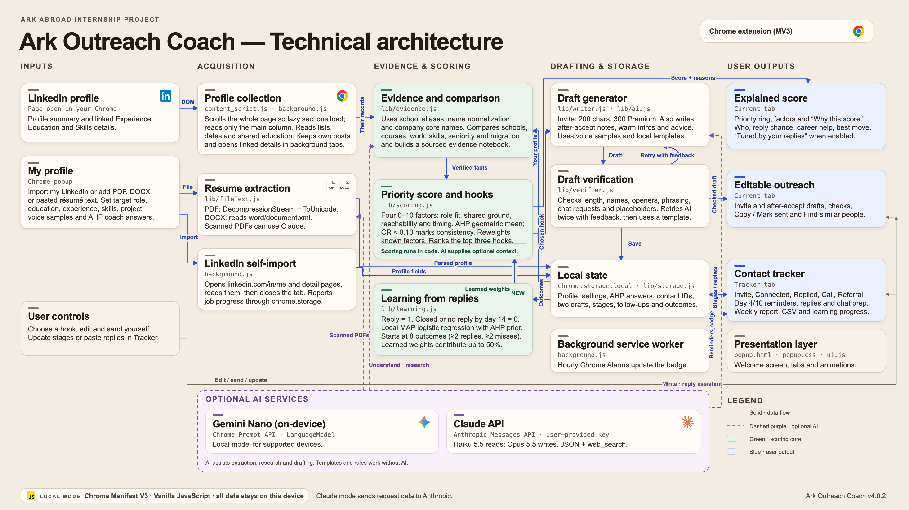

# Ark Outreach Coach

An improved version of Ark Abroad's LinkedIn outreach Chrome extension, built for the AI Product Engineering Intern assignment.

The brief was to **improve the existing extension, not rebuild it**. The first commit in this repo is the original extension exactly as Ark sent it, and every change after that is in the history.



## What it does
Ark's outreach method, built into the tool:

| Tab | What you get |
|---|---|
| **Current** | An explained **priority score** (0–100) for the open LinkedIn profile, the top 3 reasons to reach out, an invite note (≤ 200 characters) and an "after they accept" message, each checked before you see it |
| **Tracker** | Stages from Invite sent to Referral, day-4 / day-10 reminders, a reply assistant, coffee-chat prep, a weekly coach report and CSV export |
| **My profile** | Import from your own LinkedIn or upload a resume (PDF/DOCX, read on-device), coach settings (AHP weights), AI engine |

## How the score works
Four factors, each 0–10: **role fit, shared ground, reachability, timing**. The weights come from **AHP** (Analytic Hierarchy Process): the coach answers 6 pairwise questions, the geometric mean of each row gives the weights (default 46.7 / 27.8 / 16.0 / 9.5 %), and the consistency ratio (0.011) checks the answers don't contradict each other.

`score = 10 × Σ weight × points`. For example: 4×46.7% + 7×27.8% + 2×16.0% + 0×9.5% = 4.13 → **41**.

The score is calculated in code, never by AI. After 8 real outcomes the weights start learning from your replies (logistic regression with an AHP prior), and the coach always keeps at least 50% of the say.

## AI (optional)
- **Gemini Nano** on-device via Chrome's Prompt API: free and private
- **Claude** with your own API key: Haiku 5.5 reads, Opus 5.5 writes; Deep Mode adds web search
- **Templates and rules**: everything works with no AI at all

AI only reads messy text and writes drafts. Nothing is ever sent on LinkedIn automatically.

## Install
1. Open `chrome://extensions` and turn on **Developer mode**.
2. Click **Load unpacked** and pick the `linkedin extention/` folder.
3. Open any LinkedIn profile and click the Ark icon.

Requires Chrome 138+.

## Project layout
```
linkedin extention/      the extension (Manifest V3, vanilla JS, no build step)
  content_script.js      reads the LinkedIn page (waits for late-loading sections)
  background.js          detail pages, LinkedIn self-import job, reminder badge
  popup.html/css/js      the three tabs · ui.js = animations only
  lib/evidence.js        sourced evidence notebook, school/company matching
  lib/scoring.js         factor points + AHP
  lib/learning.js        weights learned from real replies
  lib/writer.js          drafts · lib/verifier.js = draft checks
  lib/ai.js              Gemini Nano / Claude / templates router
  lib/fileText.js        on-device PDF and DOCX reader
  lib/storage.js         contacts with unique IDs, stages, reminders
tests/                   55 Node tests + browser fixtures of LinkedIn layouts
loom/                    script, slides and build pipeline for the Loom video
PLAN.md · CHANGES.md     design plan and full change log
```

## Tests
```bash
node tests/run-tests.js
```
To click through the popup in a normal browser tab:
```bash
node tests/build-harness.js
python3 -m http.server 8765
```
Then open `http://localhost:8765/tests/harness.html`.

## Loom video
`loom/build.py` assembles the video from `loom/segments.json`: slides, architecture zooms and the screen recording with ElevenLabs narration.
```bash
python3 loom/build.py --voice preview      # free macOS voice
python3 loom/build.py --voice elevenlabs   # needs ~/.elevenlabs_key
```

---
Kiran Kishore Venkatesan · Amrita Vishwa Vidyapeetham, Coimbatore
